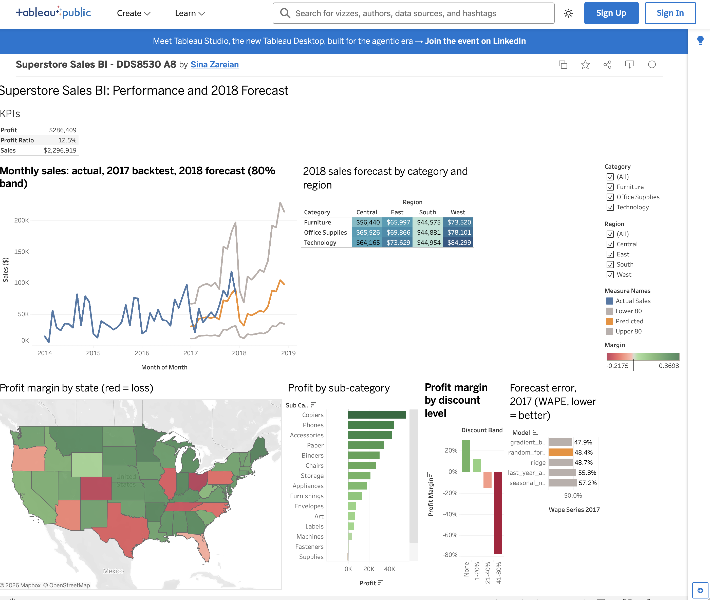

# Superstore BI Pipeline: ETL, Sales Forecasting and a Tableau Dashboard

**Live dashboard (Tableau Public):** https://public.tableau.com/app/profile/sina.zareian/viz/SuperstoreSalesBI-DDS8530A8/SuperstoreBI



DDS-8530 Big Data Integration — Signature Assignment 8 (National University)

An automated pipeline that integrates order data from a **CSV archive**, an **SQL
operational database** and a **REST API** (US public holidays), cleans and models it with **pandas** and
**SQLAlchemy**, forecasts monthly sales with **scikit-learn**, and publishes
Tableau-ready files that feed an interactive **Tableau Public** dashboard. **Apache
Airflow** (or cron) reruns everything daily.

```
 CSV archive 2014-16 ─┐
 SQL database 2017  ──┼─► extract ─► transform ─► load ─► SQLite warehouse
 Holiday API        ──┘   (pandas,   (clean,      (SQLAlchemy,     │
                           SQLAlchemy) integrate)  1 transaction)  ▼
                                                    forecast (scikit-learn, GridSearchCV)
                                                               │
                                     tableau/data/superstore_bi.xlsx + CSVs ─► Tableau dashboard
 Airflow DAG (daily 06:00): extract_csv | extract_sql | extract_api >> transform >> load_warehouse
                            >> train_forecast >> publish_tableau >> validate
```

## Layout

| Path | Purpose |
|---|---|
| `config.py` | Paths, database URLs, API endpoints (all overridable by environment variables) |
| `scripts/seed_sources.py` | Builds the two internal sources from `data/raw/superstore.csv` |
| `etl/extract.py` | CSV (chunked pandas), SQL (SQLAlchemy join), APIs (cached JSON) → `data/staging` |
| `etl/transform.py` | Schema harmonization, product-name conflicts, postal codes, duplicates, validity rules, enrichment, aggregates |
| `etl/load.py` | Transactional load into the warehouse + `etl_runs` audit table |
| `ml/forecast.py` | 12-month-ahead sales forecast per Category × Region; tuned Ridge / random forest / gradient boosting; 2017 backtest |
| `ml/churn.py` | Exploratory customer-churn model (kept for the record; not used in the dashboard — see report) |
| `etl/publish.py` | Writes `tableau/data/superstore_bi.xlsx` and CSVs; predictions also to the warehouse |
| `scripts/validate_run.py` | Post-run checks (row counts, forecast rows, freshness, sheets) |
| `run_pipeline.py` | Runs every step in one process (cron / manual) |
| `dags/superstore_bi_dag.py` | Airflow DAG; `docker-compose.yml` runs Airflow |
| `scripts/install_cron.sh` | cron alternative to Airflow |
| `tableau/BUILD_GUIDE.md` | Step-by-step dashboard build |
| `tests/` | Unit tests (`python -m pytest -q`) |

## Run it

```bash
conda create -n a8 python=3.12 -y && conda activate a8
pip install -r requirements.txt
python -m pytest -q                  # 4 tests
python scripts/seed_sources.py       # create the CSV archive and the SQL database
python run_pipeline.py               # extract -> transform -> load -> forecast -> publish -> validate
```

Outputs: `data/warehouse/superstore_bi.db`, `tableau/data/`, `results/*.json`, `logs/pipeline.log`.

### Schedule with Airflow (Docker Desktop)

```bash
docker compose up -d                 # first start installs the project venv (~2 min)
open http://localhost:8080           # admin / admin -> DAG superstore_bi_pipeline -> unpause / Trigger
docker compose down
```

### Or with cron

```bash
bash scripts/install_cron.sh         # daily 06:00, log in logs/cron.log
```

## Data

Sample Superstore (Tableau sample data, 9,994 order lines, 2014–2017); US public
holidays from the Nager.Date API (<https://date.nager.at>). API responses are cached in
`data/staging/api` so a run survives a short API outage (with a warning).
